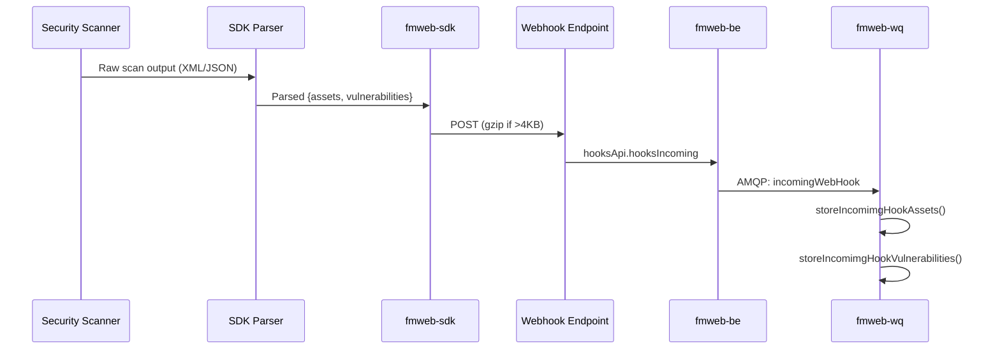

# 🧠 fmweb-sdk Agent Context (Knowledge Capture)

> [!CAUTION]
> This branch is for documentation and knowledge capture only.
> The authoritative source is **Bitbucket** (origin) with a public mirror on **GitHub**.

**Back to Root Map**: [fm-devcontainer/AGENTS.md](../fm-devcontainer/AGENTS.md)

> [!TIP]
> **Discovery Mode**: If you are reading this file, you are working in this repository. You **MUST** immediately check for and ingest all skills located in `.agent/skills/` (if any) to ensure you follow local protocols.

## Repository Overview

**Type**: V1 Public API SDK / CLI Tool
**Version**: 1.5.3
**License**: MIT
**Dependencies**: axios (HTTP), zlib (compression)

## Purpose

The FortMesa SDK enables external systems to push asset and vulnerability data into FortMesa via webhooks. It provides:

1. **Core Library** (`lib/index.js`) - Webhook submission with validation and compression
2. **CLI Parsers** (`test/*/`) - Parse output from security scanners and submit to FortMesa

## Supported Scanners (Parsers)

| Scanner | Directory | Purpose |
|:--------|:----------|:--------|
| Metasploit | `test/metasploit/` | Import Metasploit findings |
| Nessus | `test/nessus/` | Import Nessus vulnerability scans |
| NMAP | `test/nmap/` | Import NMAP network scans |
| NPM Audit | `test/npm/` | Import npm security audit results |
| OpenVAS | `test/openvas/` | Import OpenVAS vulnerability scans |
| Qualys | `test/qualys/` | Import Qualys scan results |

## API Flow



## Core API

### init(options, callback)

Initialize the SDK with webhook URL.

```javascript
const fmsdk = require('fmweb-sdk');
await fmsdk.init({
  url: 'https://api.fortmesa.com/hooks/{scopeId}/{hookId}',
  maxTTL: 86400,        // optional: max TTL in seconds
  ua: 'MyScanner/1.0',  // optional: User-Agent
  scanDate: new Date()  // optional: scan timestamp
});
```

### submit(payload)

Submit assets and/or vulnerabilities.

```javascript
await fmsdk.submit({
  assets: [
    {
      deviceId: 'unique-asset-id-123',  // required
      assetLabel: 'web-server-01',       // required
      ipAddress: '192.168.1.100',
      operatingSystem: 'Ubuntu 22.04',
      // ... more fields
    }
  ],
  vulnerabilities: [
    {
      deviceId: 'unique-asset-id-123',  // required, must match an asset
      findingId: 'CVE-2023-1234',       // required (or title)
      title: 'SQL Injection',
      severity: 'High',
      severityCVSS3Score: '8.5',
      description: 'SQL injection in login form',
      recommendation: 'Use parameterized queries'
    }
  ]
});
```

## Payload Schema

### Asset Fields

| Field | Type | Required | Description |
|:------|:-----|:---------|:------------|
| `deviceId` | string | ✅ | Unique ID (min 8 chars) |
| `assetLabel` | string | ✅ | Display name |
| `deviceName` | string | | Name of asset |
| `deviceType` | string | | Type of asset |
| `ipAddress` | string | | IP Address |
| `operatingSystem` | string | | OS name |
| `operatingSystemVersion` | string | | OS version |
| `computerName` | string | | Hostname |
| `isActive` | integer | | AWS status code |
| `isArchived` | boolean | | Archive flag |
| `unstructuredAssetInfo` | any | | Extra data |

### Vulnerability Fields

| Field | Type | Required | Description |
|:------|:-----|:---------|:------------|
| `deviceId` | string | ✅ | Asset this applies to |
| `findingId` | string | ✅* | Unique finding ID |
| `title` | string | ✅* | Vulnerability title |
| `severity` | string | | Human readable severity |
| `numericSeverity` | string | | 0-10 score |
| `severityCVSS3Score` | string | | CVSS3 score |
| `severityCVSS2Score` | string | | CVSS2 score |
| `severityCVSS3Vector` | string | | CVSS3 vector |
| `severityCVSS2Vector` | string | | CVSS2 vector |
| `description` | string | | Full description |
| `recommendation` | string | | Remediation steps |
| `lastScanDate` | datetime | | When found |
| `attributes` | object | | Extra key-value data |

*Either findingId or title is required

## Remotes

| Remote | URL | Purpose |
|:-------|:----|:--------|
| `origin` | bitbucket.org/fortmesa/fmweb-sdk | Private (authoritative) |
| `github` | github.com/fortmesa/sdk | Public mirror |

## Related Documentation

- [GUIDELINES.md](GUIDELINES.md) — Coding standards and anti-patterns
- [DECISIONS.md](DECISIONS.md) — Architectural decisions
- [fortmesa.readme.io](https://fortmesa.readme.io/) - V1/V2 API documentation
- [fmweb-be ENDPOINTS.md](../fmweb-be/.agent/api/ENDPOINTS.md) - Backend API surface
- [fmweb-wq JOBS.md](../fmweb-wq/.agent/jobs/JOBS.md) - `incomingWebHook` job type
